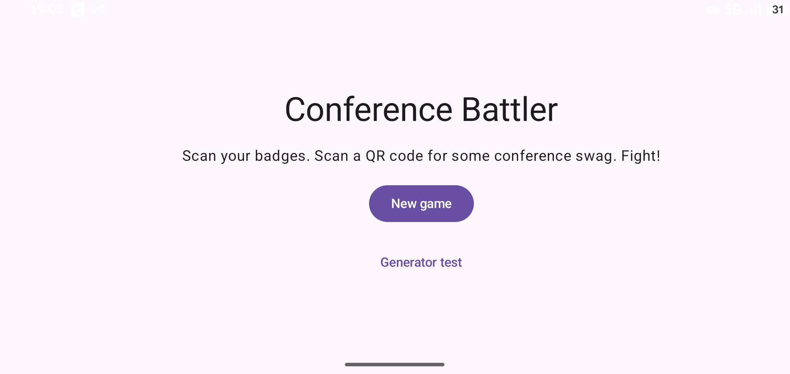
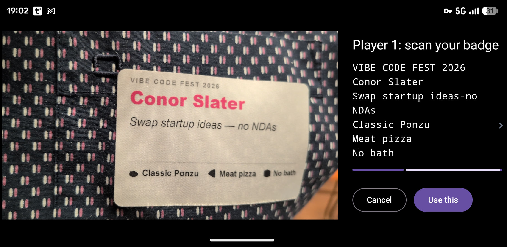
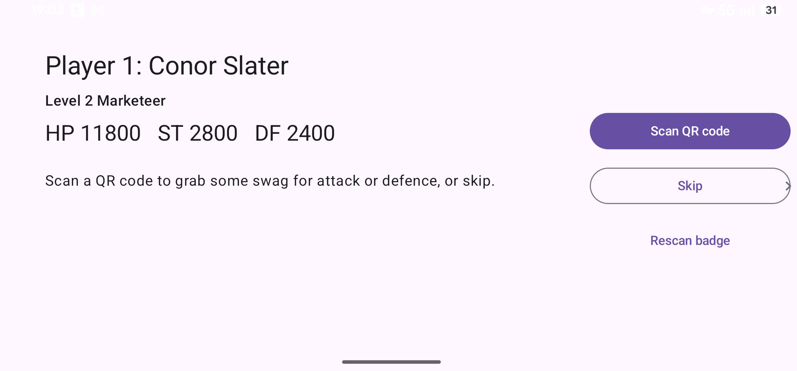
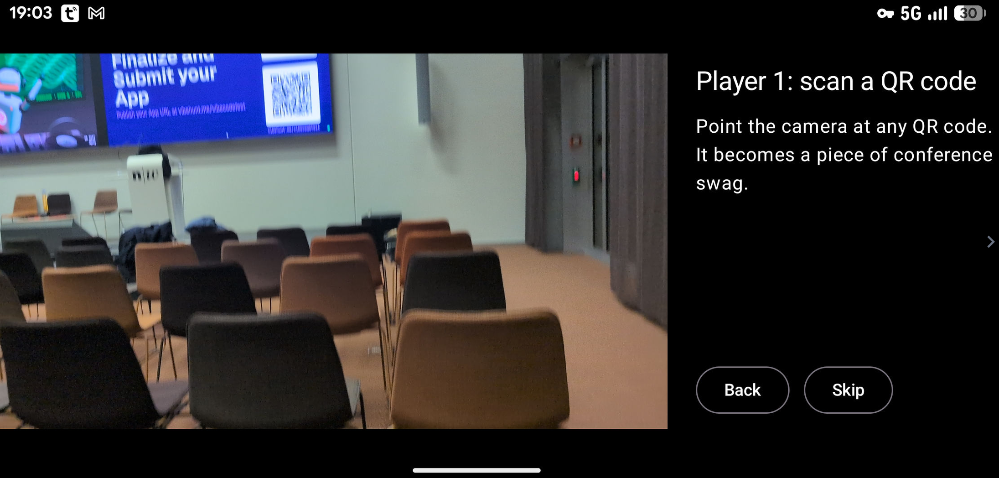
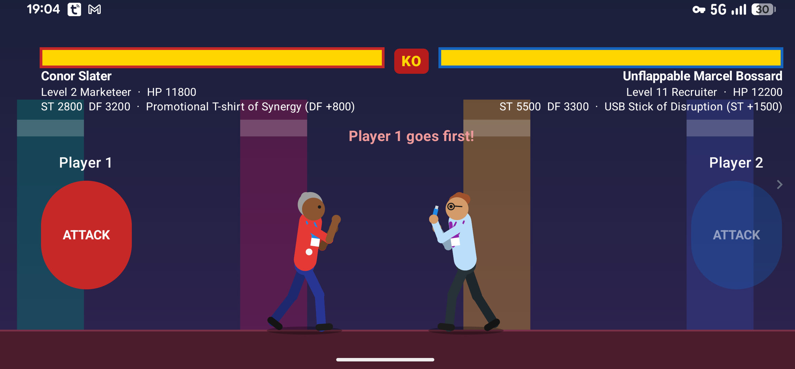
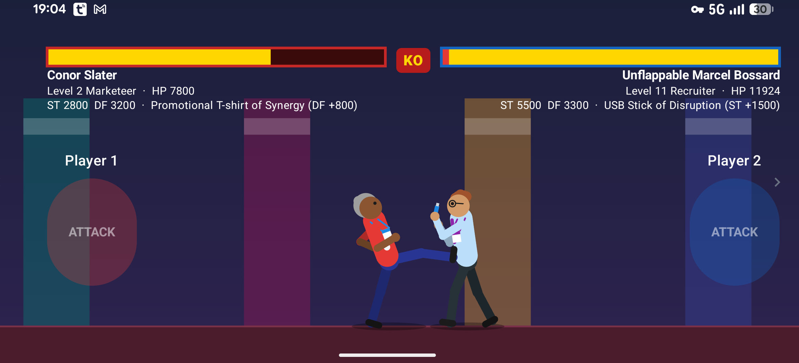
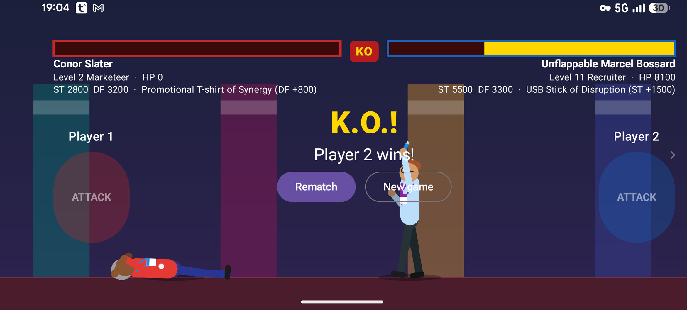

# Conference Battler

Turn your conference badge into a fighter. Scan the name badges of two attendees and each badge becomes a character with its own job title and stats. Scan any QR code for a piece of conference swag. Then fight it out, Street Fighter style, on one phone.

The game is inspired by the 1990s [Barcode Battler](https://en.wikipedia.org/wiki/Barcode_Battler), where you scanned barcodes from everyday products to create fighters.

## Why?

Conferences are full of people you haven't met yet and QR codes nobody scans. Conference Battler turns both into a game:

- **Network and make new rivals.** To play, you need someone else's badge, so you have to go and say hello. Your badge always gives the same fighter, so a rematch against the person you met at the coffee break is always on.
- **Hunt for QR codes.** Every QR code in the venue, on posters, sponsor booths, slides and lanyards, gives a different piece of swag. Some are much better than others, so it pays to explore.

## Install

The app runs on Android 8.0 or newer.

1. On your phone, download [conference-battler-v1.0.apk](https://github.com/conorslater/conference_battler/raw/main/apk/conference-battler-v1.0.apk).
2. Open the downloaded file. Android will ask you to allow installs from your browser or file manager; allow it, then tap **Install**.
3. Open **Conference Battler** and allow camera access when it asks.

To install from a computer instead, connect the phone with USB debugging on and run:

```sh
adb install apk/conference-battler-v1.0.apk
```

The app only asks for the camera. Badge reading and QR scanning happen on the phone.

## How to play

### 1. Start a new game

Turn the phone sideways and tap **New game**.



### 2. Scan your badge

Point the camera at your name badge and hold it steady. The text the app reads is listed on the right, and the badge is accepted once the bar fills, or straight away if you tap **Use this**. The biggest line on the badge, usually your name, becomes your fighter's name.



### 3. Meet your fighter

Your name decides your fighter: a job title such as Developer, Marketeer, Recruiter or the rare Keynote Speaker, a level, and three stats:

- **HP**: how much damage you can take.
- **ST** (strength): how hard you hit.
- **DF** (defence): how much of each hit you block.

Higher levels have better stats and can earn a title, such as *Unflappable*. The same name always gives the same fighter, so there's no point rescanning for a better one.



### 4. Grab some swag

Tap **Scan QR code** and point the camera at any QR code. It becomes a piece of conference swag: attack swag such as a USB stick adds to your ST, and defence swag such as a promotional T-shirt adds to your DF. Rarer swag has a bigger bonus, and a few QR codes give exclusive items. You can also tap **Skip**.



Then player 2 scans their badge and swag the same way.

### 5. Fight!

A coin toss decides who goes first. On your turn, tap your **ATTACK** button. Your fighter steps in with a combo of jabs, slaps and kicks, then finishes with an uppercut or roundhouse kick that sends the opponent flying. Then it's their turn.



- About 1 attack in 5 misses, and the defender dodges.
- Damage depends on your ST against their DF, with some luck.
- Sometimes an attack lands a ×2 bonus or a **CRITICAL** hit, with a longer combo.



### 6. K.O.!

The first fighter to reach 0 HP is knocked out. Tap **Rematch** to fight again with the same fighters, or **New game** to scan new players.



## Building from source

The project uses a [Nix](https://nixos.org) flake for the Android SDK and JDK:

```sh
nix develop
./gradlew test assembleDebug
```

The APK is written to `app/build/outputs/apk/debug/app-debug.apk`.

The app is written in Kotlin with Jetpack Compose, CameraX and Google ML Kit.

## Credits

- Fighters and swag are generated with a port of the random number generator and item affix rules from [DevilutionX](https://github.com/diasurgical/devilutionX), the open-source Diablo engine.
- The battle formulas are based on fan research into Barcode Battler II, including [finalfighter's BarcodeBattler2-Simulator](https://github.com/finalfighter/BarcodeBattler2-Simulator).
- Barcode Battler is a trademark of Epoch Co. This project isn't affiliated with Epoch.
- Built with [Claude Code](https://claude.com/claude-code).
